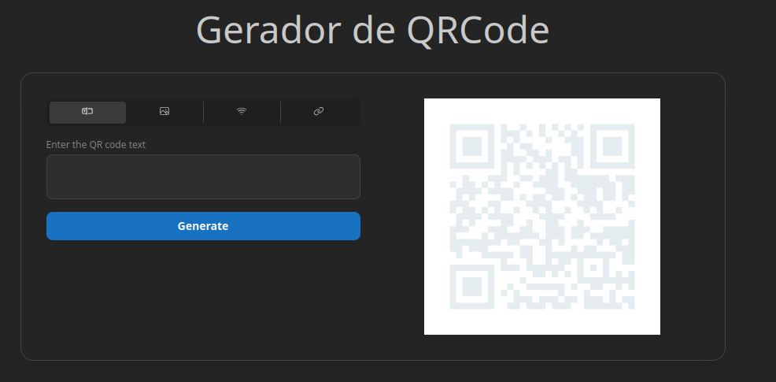

# QRCode Generator

A simple web app that generates QR codes from user input and lets you download them as images.

**[Live demo](https://dbiagi.github.io/qrcode/)**

<!-- Replace the path below with your screenshot -->


## Features

- Generate QR codes for **text**, **links** and **WiFi networks** (image QR codes are a work in progress)
- Download the generated QR code
- Available in English and Portuguese

## Built with

- [React](https://react.dev/) — UI library
- [Vite](https://vite.dev/) — build tool and dev server
- [Mantine](https://mantine.dev/) — component library
- [qr-code-styling](https://github.com/kozakdenys/qr-code-styling) — QR code rendering
- [i18next](https://www.i18next.com/) — translations

## Getting started

Requires Node.js 24+.

```bash
npm install
npm run dev
```

Then open http://localhost:5173.

### Scripts

| Command           | Description                    |
| ----------------- | ------------------------------ |
| `npm run dev`     | Start the dev server           |
| `npm run build`   | Type-check and build for production |
| `npm run preview` | Preview the production build   |
| `npm run test`    | Run tests with Vitest          |
| `npm run lint`    | Lint the code with ESLint      |

## Docker

```bash
docker build -t qrcode .
docker run -p 8080:80 qrcode
```

The app will be available at http://localhost:8080.
