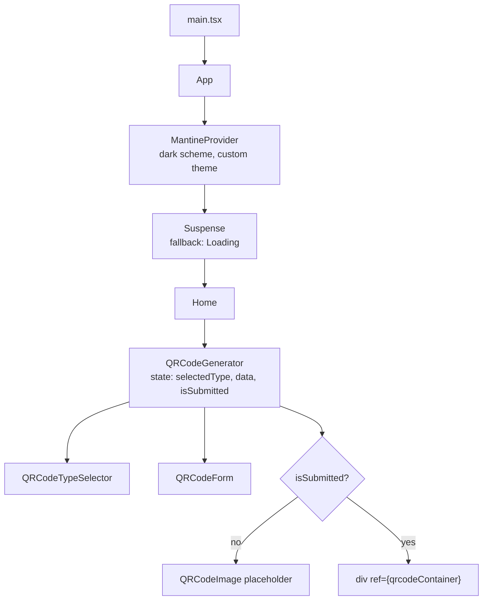
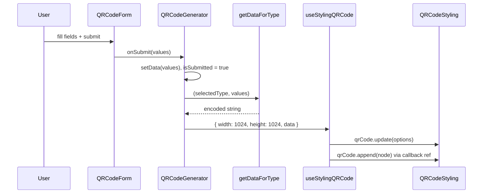

# Architecture

## Overview

Single-page app that builds QR codes from user input. It is one project, not a monorepo.

| Concern | Choice |
|---|---|
| Language | TypeScript (~6.0) |
| UI | React 19, with the React Compiler on through `@rolldown/plugin-babel` |
| Build / dev server | Vite 8 |
| Components | Mantine 9 (`@mantine/core`, `@mantine/form`, `@mantine/hooks`) and Phosphor icons |
| QR rendering | `qr-code-styling` (SVG output) |
| i18n | i18next, react-i18next and the browser language detector (`en`, `pt`) |
| Styling | Mantine style props, one CSS module, PostCSS (`postcss-preset-mantine`, `postcss-simple-vars`) |
| Tests | Vitest, Testing Library and jsdom (see [testing.md](testing.md)) |
| Deploy | GitHub Pages (`.github/workflows/deploy.yml`) and Docker (nginx) |

## Source layout

```
src/
  main.tsx                     # createRoot(#root).render(<App/>)
  App.tsx                      # providers: StrictMode > MantineProvider > Suspense > Home
  pages/Home.tsx               # <title>, <h1>, Container > Paper > QRCodeGenerator
  components/
    Loading.tsx                # Suspense fallback (centered GIF)
    qrcode/
      QRCodeGenerator.tsx      # owns state; layout of form + preview
      QRCodeTypeSelector.tsx   # SegmentedControl: text | image | wifi | link
      QRCodeForm.tsx           # @mantine/form, per-type fields, validation
      QRCodeImage.tsx          # placeholder SVG shown before submit
      QRCodeGenerator.module.css
      index.ts                 # types + getDataForType() (not a barrel)
  hooks/qrcode/useStylingQRCode/
    index.tsx                  # wraps a QRCodeStyling instance
    index.test.tsx
  helper/url.ts                # isWebUrl (http/https check via new URL)
  i18n/i18n.ts, i18next.d.ts   # i18next setup and typed resources
  locales/en.json, pt.json
```

## Component tree



## Data flow



How each type is encoded (`src/components/qrcode/index.ts`):

| Type | Encoded string | Notes |
|---|---|---|
| text | the raw text | |
| link | the raw URL | checked with `isWebUrl` |
| wifi | `WIFI:T:<enc>;S:<ssid>;P:<pw>;[H:true;];` | values are not escaped; there is an extra trailing `;` |
| image | raw string | **work in progress**: the input is disabled |

## Key abstractions

- **`useStylingQRCode`**: creates one `QRCodeStyling` instance (`useState(() => new …)`). A `useEffect` calls `qrCode.update(...)` when the options change. A callback ref appends the SVG and returns a cleanup that calls `node.replaceChildren()` (React 19 ref cleanup), so the same QR code is never appended twice. Its fixed options are SVG output, a 3% margin, error correction `Q`, Byte mode, `#222222` square dots and a white background. It returns `{ qrCode, ref }`.
- **`QR_SIZE = 1024`**: the intrinsic resolution. CSS (`.preview`) sets the display size.
- **`QRCodeForm`**: one `useForm` whose initial values hold every field of every type. A `switch` on the type decides which fields are shown. Only `link` is validated.
- **i18n**: the detector checks localStorage first, then navigator. `fallbackLng: 'en'`. On `languageChanged` it updates `<html lang>` and `document.title`. The resources are typed against `en.json` in `i18next.d.ts`.

## Build and deployment

- `vite.config.ts`: `base` is `/qrcode/` when `GITHUB_PAGES` is set, otherwise `/`. It also sets the alias `@` → `./src`.
- GitHub Actions (`deploy.yml`) runs on a push to `main` or manually, on Node 24, in this order: `npm ci`, lint, `npm run test -- --run`, a build with `GITHUB_PAGES=true`, then the Pages deploy.
- `Dockerfile` has two stages: `node:24-alpine` runs `npm ci && npm run build`, then `nginx:alpine` serves `dist/`. It uses the default nginx config.

## Known gaps / work in progress

- There is **no download feature** yet, although the README and some comments mention one. `qrCode` is returned by the hook, so `qrCode.download()` is available for adding it.
- The **image** QR type is a work in progress: the input is disabled and the `image` option is commented out in the hook.
- `pt.json` has only 3 keys, so most Portuguese text falls back to English. There is no language switcher, although `en.json` has `language.*` keys.
- `SUPPORTED_LANGUAGES` is defined twice (`i18n.ts` and `i18next.d.ts`).
- `QRCodeTypeSelector` is uncontrolled (`defaultValue="text"`).

## Design history (from git log)

The commits follow Conventional Commits (`feat:` / `fix:`). Milestones: qr-code-styling integration, then "generate for all types" (`623686a`), then image marked as WIP (`d1a6168`), a bigger SVG size for better output (`0979e59`), the Paper wrapper (`c773ff7`), the Dockerfile (`dd0c019`) and the GitHub Pages deploy (`51e4d82`).
